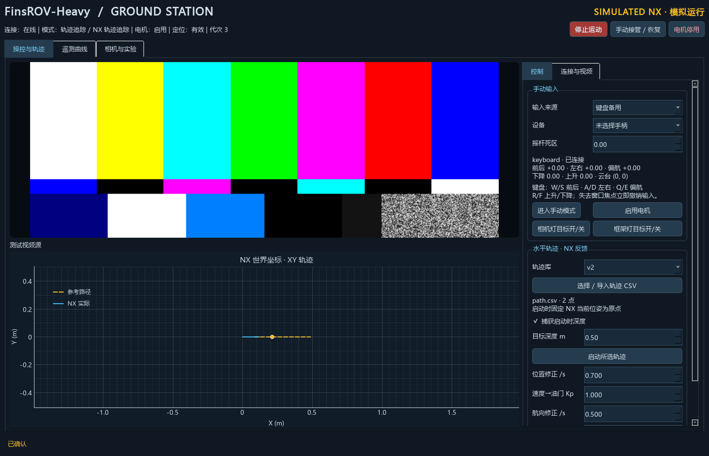

# FinsROV-Heavy Ground Station

用于 FinsROV-Heavy 的多模式上位机：手柄 / 键盘手动操控、基于 NX 惯性里程计的水平轨迹追踪，以及独立的 GStreamer 视频与实验记录。



本分支实现 **PC 上位机、MAVLink 2 协议和模拟 NX**。实际 NX 中间件与嵌入式接收端尚未迁移；目前请通过模拟器联调。新应用不接受旧 40/52 字节协议。

| 资料 | 内容 |
| --- | --- |
| [开发交接文档](docs/development-handoff.md) | 当前实现、代码入口、接口约定、验收证据与接入资料 |
| [后续开发安排](docs/roadmap.md) | NX、嵌入式、整链联调和水下实验的阶段任务与验收条件 |
| [操作与开发说明](docs/groundstation.md) | 启动、模式切换、轨迹、视频、相机和记录 |
| [通信协议](docs/protocol.md) | 消息 ID、坐标系、会话、确认、过期与重放处理 |
| [验收记录](docs/validation.md) | 自动化、模拟闭环和实机待验证项 |
| [协议 XML](protocol/finsrov.xml) | 消息、字段类型、单位与枚举的唯一来源 |
| [C 头文件](protocol/generated/c/finsrov/mavlink.h) | 后续 NX / 嵌入式对接入口 |
| [v1 轨迹](training_trajectories/v1) / [v2 轨迹](training_trajectories/v2) | 现有 CSV 轨迹库 |

## 启动模拟运行

安装 [uv](https://docs.astral.sh/uv/getting-started/installation/)，在仓库目录执行：

```powershell
uv sync --locked
uv run python -m groundstation --simulate
```

无需手柄、相机或实际 NX。选择“键盘备用”→“进入手动模式”→“启用电机”。按 W/S 前后、A/D 左右、Q/E 偏航、R/F 上下。切换轨迹前释放按键，选择 CSV，点击“启动所选轨迹”。模拟器始终显示黄色 **SIMULATED NX · 模拟运行** 标识。

Windows 也可运行 `run_monitor.bat --simulate`。启动脚本优先使用 uv；未加入 PATH 时可以使用已建立的 `.venv`。`python nx_telemetry_monitor.py` 现在也进入新界面。旧实现保留用于回归核对，历史说明见 [legacy_monitor.md](docs/legacy_monitor.md)。

## 分开启动 PC 和模拟 NX

```powershell
# 终端 1
uv run python -m groundstation.simulator --bind 127.0.0.1 --pc 127.0.0.1
# 终端 2：在“连接与视频”中点击“连接 NX”
uv run python -m groundstation --nx 127.0.0.1
```

默认 PC 接收 54321，NX 接收 54322。端口可配置，视频另用 UDP 5600。后续 NX 协议完成后，使用 `--nx 192.168.0.2` 连接实际设备。

## 开发与检查

```powershell
uv run python tools/generate_protocol.py
uv run python -m unittest discover -v
```

Python 3.12，依赖版本由 `uv.lock` 固定。Python/C 对照测试需要 C11 编译器（设置 `CC`）；视频集成测试需要 [GStreamer](https://gstreamer.freedesktop.org/download/)（`gst-launch-1.0` 加入 PATH 或设置 `GST_LAUNCH`）。缺少任一外部工具时，对应测试会明确显示 `skipped`，不算已验证。
