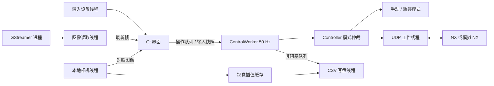

# 操作与开发说明

## 运行环境

Python 3.12；PySide6、pyqtgraph、pygame-ce、pymavlink、OpenCV contrib 由 `uv sync --locked` 安装。`uv.lock` 为本分支的可复现依赖记录。不要混用全局 Python 的 Qt / OpenCV 安装。

```powershell
uv run python -m groundstation --help
uv run python -m groundstation --simulate
uv run python -m groundstation --nx 127.0.0.1 --port 54321 --nx-port 54322
```

本机模拟与单独模拟器只能选择一种，避免重复占用端口。首次握手需要能力确认与时间同步；两者完成前不会输出有效运动指令。界面中“模式”显示 PC 当前模式与 NX 报告模式，电机启用状态独立显示。

## 手动输入

在“控制”中选择手柄设备。插拔自动检测，重新连接后需重新选择设备、回中并点击“手动接管 / 恢复”。默认死区为 0，不重新缩放摇杆比例。

| 原始输入 | 机体输出 / 动作 |
| --- | --- |
| `-axes[0]` | 偏航，逆时针为正 |
| `-axes[3]` | 前后，向前为正 |
| `-axes[2]` | 左右，向左为正 |
| `(axes[4]+1)/2` | 下降 |
| `(axes[5]+1)/2` | 上升 |
| `buttons[6]` | 电机目标启用状态 |
| `buttons[0]` / `buttons[1]` | 相机灯 / 框架灯目标状态 |
| `hat[0]` / `hat[1]` | 云台水平 / 俯仰 |

与已发布 `V5StreamerNX.py` 的轴编号、方向和按钮含义一致。按钮仅处理按下沿；初次连接时已经按住的键不触发。动作转换为绝对目标状态并等待 ACK，重试不产生第二次“切换”。

“键盘备用”是独立的手动来源：W/S 前后、A/D 左右、Q/E 偏航、R/F 上下，幅值 0.5。编辑输入框不会产生运动；窗口失焦清除按键并使手动输入失效。键盘与手柄不会同时供给机体运动指令。切换输入来源会先停止。

## 水平轨迹

CSV 表头严格为 `x_m,y_m,yaw_rad,duration_s`，至少两点，首点 XY 为 0，所有数据有限且每段时长为正。可选 v1/v2 或外部同格式 CSV。

1. 建立连接，选择手动来源并回中，进入手动模式，明确启用电机。
2. 加载轨迹，选择捕获启动深度（默认）或输入目标深度。
3. 点击启动。收到模式确认后，以当时 NX 位姿固定轨迹原点：`p_world = p_start + R(yaw_start) p_local`，`yaw_world = wrap(yaw_start + yaw_local)`。
4. 逐段规划，每行 `duration_s` 是从上一点到该点的设定时间；同时满足位置误差 ≤ 0.15 m 和航向误差 ≤ 10°才推进。超出设定时间但未到点时继续收敛，不强行跳到下一点。

参考速度加位置误差修正后，与 NX 实际世界速度作差，乘速度到油门比例，再转换为机体指令；平面向量限幅 1、偏航限幅 ±1，并限制每秒变化率。原始默认参数为：位置 Kp 0.70 /s，速度→油门 Kp 1.0，航向 Kp 0.50 /s，偏航满量程 0.40 rad/s，输出变化率 1.0 /s。控制过程仅读取 NX 位姿和速度，不读取 AprilTag。

轨迹完成后，水平和偏航输出为 0，继续发送已确认的定深目标。不会重新开始，也不会自动接入偏转中的手柄。点击“停止运动”会撤销包括定深在内的运动输出；“电机停用”另外发送停用目标状态。两者与顶部“手动接管 / 恢复”始终可见。

模式切换先清零旧输出，再申请新代次，收到匹配 ACK 才启用。手柄掉线、输入超过 200 ms、自动模式定位无效 / 过期、里程计坐标系重置都会停止；数据恢复不自动重启。恢复轨迹需要重新启动，重新捕获原点。

## GStreamer 视频

安装官方 [Windows GStreamer runtime](https://gstreamer.freedesktop.org/download/)，需要 `udpsrc`、`rtpjitterbuffer`、`rtph264depay`、`h264parse`、`avdec_h264`、`videoconvert`、`videoscale`、`fdsink`。界面的“连接与视频”允许配置可执行文件完整路径、端口、分辨率和 jitter 延迟。宽度须为 4 的倍数，以固定 RGB 行跨度。

默认 UDP 5600、H.264/RTP、PT 96、时钟 90000，解码为 1280×480 RGB，缓存 50 ms。GStreamer 独立进程通过 stdout 管道给读取线程，队列只保存最新帧。RTP 断流显示状态，恢复后继续显示；解码进程异常退出可点击重启。缺少运行库时其他功能仍可用。

```powershell
# 内置测试源：打开界面后点击“启动 / 重启视频”
uv run python -m groundstation --simulate --video-test --gst "C:\gstreamer\1.0\msvc_x86_64\bin\gst-launch-1.0.exe"

# 独立 RTP 测试发送端（需要 x264enc 插件）
gst-launch-1.0 -q videotestsrc is-live=true ! video/x-raw,width=640,height=480,framerate=30/1 ! videoconvert ! x264enc tune=zerolatency speed-preset=ultrafast key-int-max=30 ! rtph264pay pt=96 config-interval=1 ! udpsink host=127.0.0.1 port=5600
```

GStreamer 自 1.28 也提供官方 Python wheels（见下载页）；本项目不把整套视频运行库作为必要 Python 依赖。测试截图中的彩条来自实际 GStreamer `videotestsrc`。

## AprilTag、录像与 CSV

“相机与实验”选择本地相机索引、标定 YAML 与 Tag 布局 JSON。保持原 25h9 Tag 布局、质量门限和插值逻辑。请求 1920×1080@30 FPS，用 1280×720 副本进行定位；MP4 录制原始 1080P。若实际分辨率不满足要求，明确拒绝启动录像。停止录像或关闭相机会释放 VideoWriter 并封装文件。相机缺失或标定文件缺失只影响该页面。

CSV 会话保存到 `recordings/<时间>/`：

| 文件 | 内容 |
| --- | --- |
| `telemetry.csv` | 每个接收并接受的 NX 采样；原九项预测量和 Tag 列，新增源时间、接收时间、模式、代次、参考、指令、深度和质量标志 |
| `aligned.csv` | 仅具有严格前后视觉帧插值的行，保持原 14 列实验格式 |
| `session.json` | 协议版本、连接 / 控制配置、输入选择、深度设置、相机路径、模拟标记 |
| `trajectory.csv` | 开始记录时所选轨迹的原始副本（已选择时） |
| `result.json` | 写入 / 对齐 / 丢弃计数 |

记录时锁定轨迹文件、控制参数和深度设置，变更前结束会话。`source_us` 为 NX 单调时钟；`source_pc_monotonic` 是时间同步后的 PC 时钟，用于 Tag 插值。接收时间单独保存。输出指令与参考值表示接收采样时 PC 已知的最新控制输出，不声称与传感器源时刻严格同步。网络预测遥测超过 200 ms 或无有效位时留空；Tag 缺失留空而保留 NX 行。严格导出最多等待 0.5 s 的后续相机帧，该等待只发生在写盘线程。

写盘队列容量 5000，满时计数丢弃并在界面 / CSV 显示，不阻塞控制。传输队列、图像队列也有上限。系统调度非硬实时，50 Hz 实测统计在“遥测曲线”中显示；实机阶段仍须由 NX / 嵌入式独立实现超时保护。

## 代码组织与扩展



| 模块 | 责任 |
| --- | --- |
| `models.py` / `modes.py` | 数据类型、纯控制模式、局部轨迹变换 |
| `controller.py` | 唯一发送仲裁器、会话、代次、动作确认和故障锁存 |
| `trajectory_tracking.py` | 既有逐点规划、速度映射、限幅与斜率限制 |
| `wire.py` / `generated/` | UDP 队列和生成的 MAVLink 编解码 |
| `runtime.py` / `inputs.py` | 50 Hz 调度、手柄与键盘输入适配 |
| `video.py` / `camera.py` | 网络视频与独立本地相机 |
| `recording.py` / `app.py` | 会话记录与 Qt 展示 |
| `simulator.py` | 同协议模拟 NX，无物理执行器接口 |

新增模式实现 `ControlMode.enter/update/exit`，返回 `Setpoint`，在仲裁器注册并增加模式入口、XML 模式枚举及能力位。模式不得自行发送网络消息或访问 Qt / 摄像头；无需改动视频、记录与 MAVLink 封装。任何新增字段先改 XML，再生成 Python/C 和更新公共测试向量。修改有效期、状态转换、恢复策略时应补充模拟测试。
